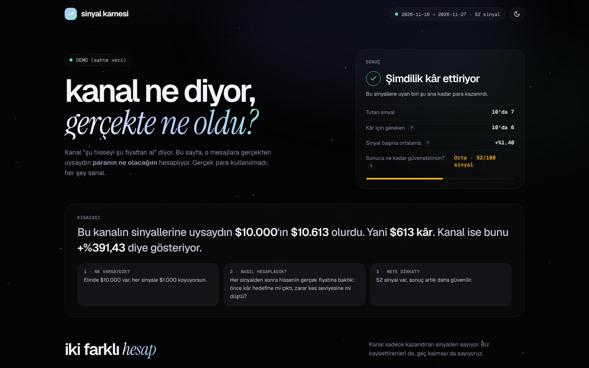

# 📊 Sinyal Test Botu

**Telegram'daki borsa sinyal kanalları gerçekten kazandırıyor mu?** Bu bot, bir kanalın verdiği her "al" sinyalini **gerçek dakika dakika fiyatlarla** test eder. Sonra kanalın gösterdiği kâr ile gerçekte olacak kâr/zararı yan yana koyar.

> Gerçek işlem yapmaz, para kullanmaz. Her şey sanal hesapla hesaplanır.



*(Görseldeki veriler örnek/demo verisidir.)*

---

## Neden yaptım?

Telegram'daki sinyal kanalları genelde "bu hafta 42 sinyalin 42'si kâr, toplam +%484" gibi özetler paylaşıyor. Bu rakamlar zarar eden sinyalleri saymıyor, takip edenlerin yaşadığı gecikmeyi ve ücretleri de hesaba katmıyor.

Bu botu, bir kanala gerçek para yatırmadan önce iddialarını **rakamlarla sınamak** için yazdım.

**İlk gerçek test (bir kanalın 16-20 Kasım 2026 haftalık özeti, 42 sinyal):**

| | Sonuç |
|---|---|
| Kanalın iddiası | 42/42 kâr, **+%484** |
| Kanalın kendi kurallarıyla, kayma ve gecikme olmadan | 41 sinyalden 24'ü hedefe, 17'si önce zarar kese |
| Bot gerçekten girseydi ($10.000 sanal hesap) | **$9.155, yani −%8.5** |
| Bot 1 dk geç kalsa / elle alınsa / farklı satış stratejisi | 6 durumun **6'sında da zarar** |

*Özette zarar kes seviyesi yazmadığı için girişin %7.5 altı varsayılmıştır. Tek haftalık bir örneklemdir.*

---

## Özellikler

- **Haftalık özet testi:** Kanalın paylaştığı özeti yapıştır, bot her sinyali o günün gerçek fiyatlarıyla kontrol etsin. Telegram kurulumu gerekmez.
- **Canlı Telegram dinleyici:** Yazılı sinyal atan kanalları 7/24 izler ve her sinyali kaydeder. Bildirimi o anki fiyatla birlikte Telegram'a gönderir.
- **Silme ve düzenleme takibi:** Kanal kaybettiren bir sinyali silerse ya da sonradan değiştirirse, bot ilk hâlini saklar ve hesaba katar.
- **Kanal vs gerçek:** Aynı sinyalleri iki hesapla değerlendirir. Biri kanalın usulü (sadece kazananlar toplanır), diğeri gerçekçi hesap (kayma, komisyon, gecikme dahil).
- **6 senaryo:** Bot anında alsa, 1 dk geç kalsa, telefondan elle alınsa × iki farklı satış stratejisi.
- **Yeni başlayanlar için panel:** Borsa terimi bilmeyen biri de anlasın diye sade Türkçe yazıldı. Her terimin yanında açıklama baloncuğu, sayfa sonunda sözlük var.
- **Gün sonu karnesi:** Her iş günü özet ve panel Telegram'a otomatik gelir.
- **21 otomatik test.**

## Dürüst test kuralları

- Mesaj gelmeden alım yapılamaz.
- Alış ve satışta %1 kayma ile %0.1 komisyon hesaplanır.
- Fiyat alış seviyesinin %3'ten fazla üstüne kaçtıysa sinyal "yetişilemedi" sayılır.
- Aynı dakikada hem kâr hedefi hem zarar kes görülürse **zarar** sayılır (en kötü ihtimal).

## Kullanım (Windows)

1. [Python 3.11+](https://www.python.org/downloads/) kur. Kurulumda "Add to PATH" kutusunu işaretle.
2. `kurulum.bat` → kütüphaneleri kurar ve testleri çalıştırır.
3. **Haftalık özet testi:** `OZET_TEST.bat` → özeti yapıştır → rapor tarayıcıda açılır.
4. **Canlı dinleme (isteğe bağlı):** [my.telegram.org](https://my.telegram.org) adresinden API anahtarı al, `.env` dosyasını doldur, sonra `BASLAT.bat`.

> ⚠️ `.env` ve `*.session` dosyaları Telegram hesabının anahtarıdır. Asla paylaşma ve repoya yükleme (`.gitignore` bunları zaten dışarıda tutuyor).

## Yapı

```
sinyal_parser.py   Telegram mesajından sinyal ayıklama
ozet_aktar.py      Haftalık özet metnini okuma
listener.py        Telegram dinleyici (Telethon)
piyasa.py          1 dakikalık fiyat verisi (Yahoo Finance, önbellekli)
simulate.py        "Kanalın gözü" ve "botun gözü" simülasyonu
evaluate.py        Senaryolar, istatistikler, Telegram özeti
rapor.py           Tek dosyalık HTML panel
db.py              SQLite kayıt
tests/             Otomatik testler
```

**Teknolojiler:** Python, Telethon, pandas, yfinance, SQLite, vanilla JS/SVG

---

### English summary

A tool that checks whether Telegram stock-signal channels actually make money. It parses each signal (entry / stop / targets) from live messages or weekly recap posts. Then it replays the signal against real 1-minute price data, with slippage, fees and execution delay, and compares the channel's advertised gains with realistic paper-trading results. In its first real test, a week the channel advertised as "42/42 winners, +484%" came out at **−8.5%** on a simulated account. No real trades are placed.

*Eğitim ve analiz amaçlıdır. Yatırım tavsiyesi değildir.*

Lisans: MIT · Yazı tipleri: SIL OFL 1.1 (bkz. `FONTS-LICENSE.txt`)
