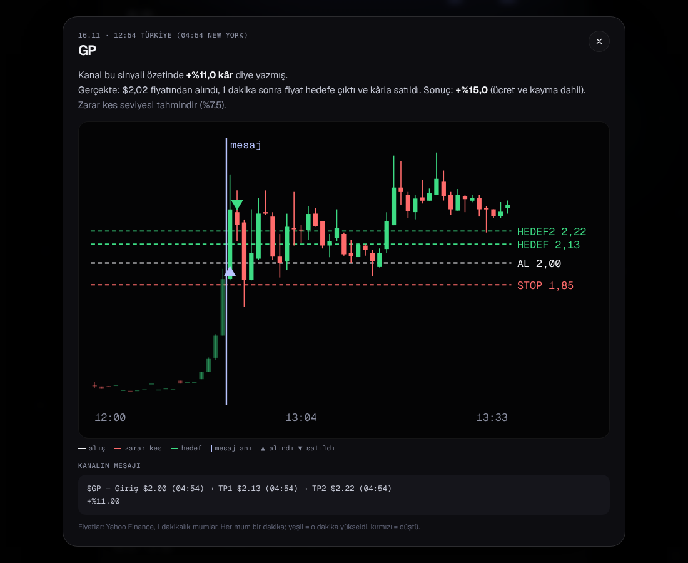

# 📊 Sinyal Test Botu

**Telegram'daki borsa sinyal kanalları gerçekten kazandırıyor mu?** Bu bot, bir kanalın verdiği her "al" sinyalini **gerçek dakika dakika fiyatlarla** test eder ve kanalın gösterdiğiyle gerçekte olacak olanı yan yana koyar.

> Gerçek işlem yapmaz, para kullanmaz. Her şey sanal hesapla hesaplanır.


---

## Neden yaptım?

Telegram'daki sinyal kanalları genelde "bu hafta 42 sinyalin 42'si kâr, toplam +%484" gibi özetler paylaşıyor. Bu hesap kaybettiren sinyalleri, takip edenin geç kalmasını ve ücretleri saymıyor.

Bu botu, bir kanala gerçek para yatırmadan önce iddialarını **rakamlarla sınamak** için yazdım.

### İlk gerçek test: Bir kanalın 16-20 Kasım 2026 haftalık özeti (42 sinyal)

| | Sonuç |
|---|---|
| Kanalın kendi özetinde | 42/42 "kâr", **+%484** (42 sinyalin yüzdeleri toplanmış) |
| Gerçek fiyatlara göre, kayma ve ücret olmadan | 41 sinyalden 23'ü hedefe, 18'i önce zarar kese ulaştı |
| Sanal hesapla (kayma, ücret dahil) | **$10.000 → $9.068, yani −%9,3** |
| Kâra geçmek için gereken | 10 sinyalden 6,6'sının tutması; gerçekte 4,5 tuttu |
| Farklı alım hızları ve satış stratejileri | Denenen 6 durumun **6'sında da zarar** |

**Sınırlamalar:** Özette zarar kes seviyesi yazmadığı için girişin %7,5 altı varsayıldı. Panelde bu değeri değiştirip kendin deneyebilirsin. Bu tek haftalık bir örneklemdir ve kanalın niyeti hakkında bir yargı değildir.

---

## Panel (v2)

- **Tek bakışta cevap:** "Bu sinyallere uysaydın paran ne olurdu?" sorusunun cevabı ve kanalın gösterdiği rakam yan yana.
- **Neden?** 10 sinyalden kaçının tuttuğu ve kâra geçmek için kaçının tutması gerektiği tek bir çubukta.
- **Kanıt:** Herhangi bir sinyale tıkla; o anın gerçek 1 dakikalık mum grafiği, kanalın mesajı ve neler olduğunun düz Türkçe anlatımı açılır.
- **Farklı varsayımlarla dene:** Kasa, alım hızı (bot / 1 dk geç / elle), satış zamanı ve zarar kes tahmini. Bu bölüm kapalı gelir, isteyen açar.
- **Tamamen çevrimdışı tek dosya.** Sayfadaki hesabın Python botuyla kuruşu kuruşuna aynı sonucu verdiği test edildi.



## Dürüstlük ilkesi

Bu projenin amacı **ikna etmek değil, dürüstçe göstermek.**
- Kanalın kendi rakamı da gösterilir, gerçekçi hesap da. Nereden geldikleri yazar.
- Tahmin edilen her şey "TAHMİN" diye işaretlenir ve değiştirilebilir.
- Verinin sınırları (eksik dakikalar, az örneklem) sayfada açıkça yazar.
- Hesap belirsiz kaldığında (aynı dakikada hem hedef hem zarar kes görülmesi gibi) kötü ihtimal seçilir; kanalın lehine olan varsayımlar da (giriş dakikasını teste dahil etmek gibi) açıkça yazar.
- Bulunan hatalar düzeltilip açıklanır. v2'de iki tane düzeltildi: v1'de "kanalın iddiası" yanlış etiketlenmişti, bir de Yahoo'nun 1.3999999 gibi verdiği fiyatlar bir sinyalin yanlış sayılmasına yol açıyordu.

---

## Özellikler

- **Haftalık özet testi:** Kanalın paylaştığı özeti yapıştır, bot her sinyali o günün gerçek fiyatlarıyla kontrol etsin. Telegram kurulumu gerekmez.
- **Canlı Telegram dinleyici:** Yazılı sinyal atan kanalları 7/24 izler. Her sinyali kaydeder ve o anki fiyatla birlikte sana bildirir.
- **Silme ve düzenleme takibi:** Kanal bir sinyali silerse ya da değiştirirse ilk hâli saklanır ve hesaba katılır.
- **Gün sonu karnesi:** Her iş günü özet Telegram'a otomatik gelir.
- **23 otomatik test.**

## Kullanım (Windows)

1. [Python 3.11+](https://www.python.org/downloads/) kur. Kurulumda "Add to PATH" kutusunu işaretle.
2. `kurulum.bat` → kütüphaneleri kurar, testleri çalıştırır.
3. **Haftalık özet testi:** `OZET_TEST.bat` → özeti yapıştır → rapor tarayıcıda açılır.
4. **Canlı dinleme (isteğe bağlı):** [my.telegram.org](https://my.telegram.org) adresinden API anahtarı al, `.env` dosyasını doldur, sonra `BASLAT.bat`.

> ⚠️ `.env` ve `*.session` dosyaları Telegram hesabının anahtarıdır. Asla paylaşma; `.gitignore` bunları zaten repodan uzak tutuyor.

## Yapı

```
sinyal_parser.py   Telegram mesajından sinyal ayıklama
ozet_aktar.py      Haftalık özet metnini okuma
listener.py        Telegram dinleyici (Telethon)
piyasa.py          1 dakikalık fiyat verisi (Yahoo Finance, önbellekli)
simulate.py        "Kanalın gözü" ve "botun gözü" simülasyonu
evaluate.py        Senaryolar, istatistikler, Telegram özeti
rapor.py           Tek dosyalık HTML panel (hesap motoru dahil)
db.py              SQLite kayıt
tests/             Otomatik testler
```

**Teknolojiler:** Python, Telethon, pandas, yfinance, SQLite, vanilla JS/SVG

---

### English summary

A tool that checks whether Telegram stock-signal channels actually make money. It reads each signal (entry / stop / targets) from live messages or weekly recap posts, then replays it against real 1-minute price data with slippage, fees and execution delay. The channel's advertised gains are shown next to realistic paper-trading results. In its first real test, a week the channel advertised as "42/42 winners, +484%" came out at **−9.3%** on a simulated account (stop-loss level assumed at 7.5%, adjustable in the report). No real trades are placed.

### Sürüm geçmişi
- **v2:** Sade panel (tek bakışta cevap, "neden?" çubuğu, tıklanabilir kanıt grafikleri, kapalı ayarlar bölümü). Kanalın kendi iddiası doğru etiketlendi. Fiyat yuvarlama hatası düzeltildi.
- **v1:** Telegram dinleyici, haftalık özet testi, 6 senaryolu rapor

*Eğitim ve analiz amaçlıdır. Yatırım tavsiyesi değildir.*

Lisans: MIT · Yazı tipleri: SIL OFL 1.1 (bkz. `FONTS-LICENSE.txt`)
